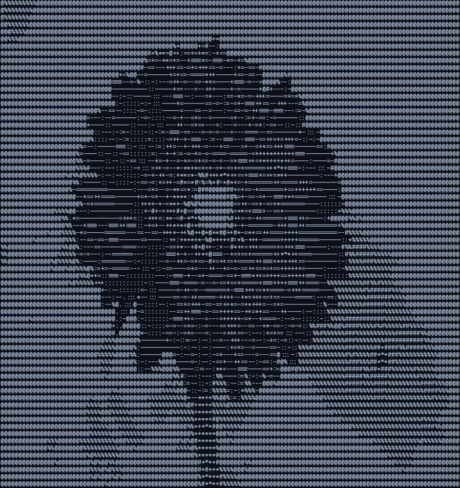

# ASCIIArt

A Java program that turns an image into ASCII art in the terminal.

## How it works

1. Load the image and scale it down to 128x72.
2. Calculate the brightness of every pixel: `0.2126R + 0.7152G + 0.0722B`.
3. Map each brightness value to a character from the density string `@%#*+=-:.`.
4. Print the result to the terminal.

## Example

### Original


### ASCII Art



## Run

```bash
javac -d out src/*.java
java -cp out Main
```
